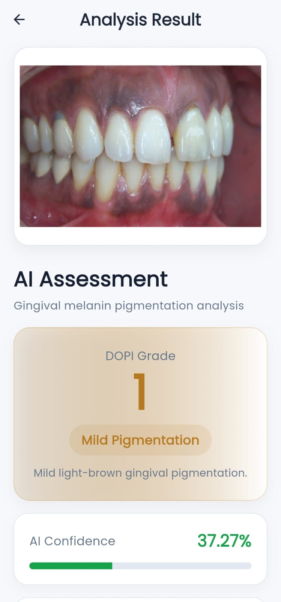
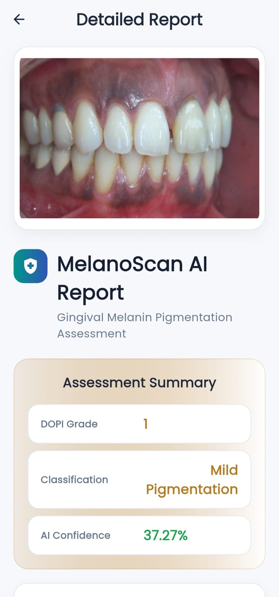
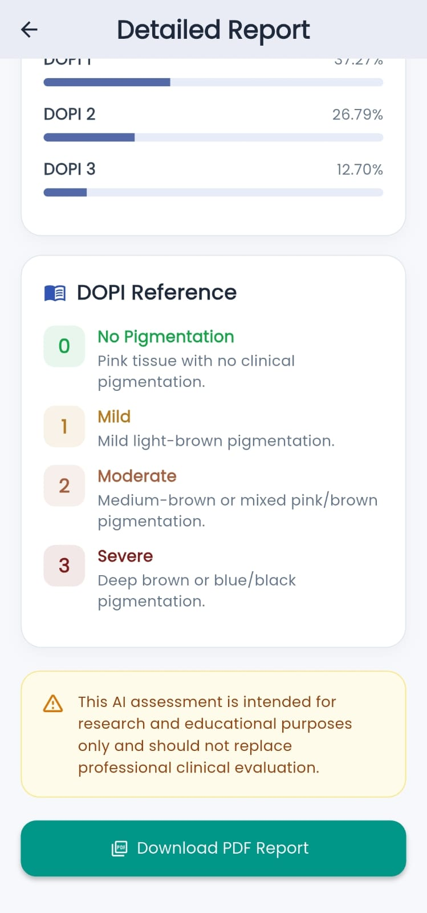

# 🦷 MelanoScan AI

### AI-Based Gingival Melanin Pigmentation Assessment System

MelanoScan AI is an **AI-powered mobile application** designed to assess gingival melanin pigmentation from intraoral images.

The system combines a **Flutter mobile application**, **Python Flask REST API**, and an **EfficientNetB0 deep learning model** to classify gingival pigmentation according to four Dummett-Gupta Oral Pigmentation Index (DOPI) grades (0–3).

> **Note:** MelanoScan AI is a research and educational prototype. Its current model was evaluated on a synthetic pigmentation dataset and has not undergone clinical validation. It should not be used as a substitute for professional clinical evaluation.

---

## 📱 Project Overview

MelanoScan AI provides an end-to-end workflow for AI-assisted gingival pigmentation assessment:

```text
Intraoral Image
      ↓
Flutter Mobile Application
      ↓
Flask REST API
      ↓
Image Preprocessing
      ↓
Gingiva-Focused Analysis
      ↓
EfficientNetB0
      ↓
DOPI Classification (0–3)
      ↓
Assessment Results
      ↓
PDF Assessment Report
```

---

## ✨ Key Features

- 📷 Upload intraoral/gingival images
- 🦷 Gingiva-focused image preprocessing
- 🧠 EfficientNetB0-based deep learning classification
- 📊 Four-class DOPI pigmentation classification
- 📈 AI confidence score
- 📉 Prediction probabilities for all DOPI classes
- 📋 Clinical interpretation based on DOPI classification
- 📄 Automated structured PDF assessment report
- 📱 Flutter-based mobile application
- 🔗 REST API communication between mobile app and AI backend

---

## 🧠 DOPI Classification

The system classifies pigmentation into four categories:

| DOPI Grade | Classification | Description |
|---|---|---|
| **DOPI 0** | No Pigmentation | Pink tissue with no clinical pigmentation |
| **DOPI 1** | Mild | Mild light-brown pigmentation |
| **DOPI 2** | Moderate | Medium-brown or mixed pink/brown pigmentation |
| **DOPI 3** | Severe | Deep brown or blue/black pigmentation |

---

## 🤖 Deep Learning Model

The classification model is based on **EfficientNetB0** with transfer learning.

### Model Configuration

- **Architecture:** EfficientNetB0
- **Input Size:** 224 × 224 × 3
- **Output Classes:** 4
- **Classes:** DOPI 0, DOPI 1, DOPI 2, DOPI 3
- **Data Augmentation:** Flip, Rotation, Zoom and Contrast
- **Classification Layer:** Global Average Pooling + Dropout + Dense Softmax

The training process used a two-phase transfer learning strategy:

1. Initial training with the pretrained EfficientNetB0 base frozen.
2. Fine-tuning of the final layers with a lower learning rate.

---

## 📊 Experimental Results

Two approaches were evaluated:

| Approach | Test Accuracy | Macro F1 |
|---|---:|---:|
| Baseline Full-Image Model | **38.18%** | 0.3656 |
| Proposed Gingiva-Focused Model | **53.04%** | 0.5069 |

The gingiva-focused approach improved test accuracy by:

### **14.86 percentage points**

The proposed model showed stronger recognition of **DOPI 0** and **DOPI 3**, while **DOPI 1** and **DOPI 2** remained more challenging classes.

> These results are from the project's synthetic evaluation dataset and should not be interpreted as clinically validated diagnostic accuracy.

---

## 🏗️ System Architecture

```text
                     ┌─────────────────────┐
                     │   Flutter Mobile    │
                     │      Application    │
                     └──────────┬──────────┘
                                │
                         Gingival Image
                                │
                                ▼
                     ┌─────────────────────┐
                     │    Flask REST API   │
                     └──────────┬──────────┘
                                │
                                ▼
                     ┌─────────────────────┐
                     │ Image Preprocessing │
                     │   & Gingiva Focus   │
                     └──────────┬──────────┘
                                │
                                ▼
                     ┌─────────────────────┐
                     │    EfficientNetB0   │
                     │   Deep Learning     │
                     └──────────┬──────────┘
                                │
                                ▼
                        ┌───────────────┐
                        │  DOPI 0 – 3   │
                        └───────┬───────┘
                                │
                     ┌──────────┴──────────┐
                     ▼                     ▼
              Result Screen          PDF Report
```

---

## 🛠️ Technology Stack

### Mobile Application

- Flutter
- Dart
- HTTP REST communication
- Image Picker
- PDF generation

### Backend

- Python
- Flask
- Flask-CORS
- REST API

### Artificial Intelligence

- TensorFlow
- Keras
- EfficientNetB0
- NumPy
- OpenCV
- Scikit-learn

### Development & Deployment

- Git
- GitHub
- Render

---

## 📂 Project Structure

```text
MelanoScan-AI/
│
├── backend/
│   ├── models/
│   ├── routes/
│   ├── utils/
│   ├── uploads/
│   ├── results/
│   ├── app.py
│   ├── config.py
│   └── requirements.txt
│
├── lib/
│   ├── screens/
│   ├── services/
│   └── ...
│
├── assets/
│   └── images/
│
├── model/
│   └── gingiva_dopi_classifier.keras
│
├── screenshots/
│   ├── 1.jpeg
│   ├── 3.jpeg
│   └── 5.jpeg
│
├── pubspec.yaml
├── .gitignore
└── README.md
```

---

## 🚀 Application Workflow

1. User selects or captures an intraoral image.
2. Flutter sends the image to the Flask backend.
3. The backend validates and preprocesses the image.
4. The image is analyzed using the trained EfficientNetB0 model.
5. The system predicts one of the four DOPI grades.
6. The mobile application displays:
   - DOPI grade
   - Classification
   - AI confidence
   - Prediction probabilities
   - Clinical interpretation
7. A structured PDF assessment report can be generated.

---

## 📸 Application Screenshots

### Analysis Result



### Detailed Report



### PDF Assessment Report



---

## 📄 Assessment Report

The application generates a structured PDF report containing:

- Analyzed intraoral image
- DOPI grade
- Pigmentation classification
- AI confidence
- Prediction probabilities
- Clinical interpretation
- DOPI reference table
- Assessment details
- Research/educational disclaimer

---

## 🔬 Dataset

The project uses gingival image data together with a synthetic pigmentation generation approach for model development and evaluation.

The dataset contains four balanced DOPI classes:

- DOPI 0
- DOPI 1
- DOPI 2
- DOPI 3

The current experimental evaluation uses **1,956 synthetic images**, derived from **489 source gingival images**.

> The synthetic dataset is intended for research and prototype development. A larger expert-labelled clinical dataset is required for reliable clinical validation.

---

## ⚠️ Limitations

- Current evaluation is based on synthetic pigmentation data.
- The model has not been clinically validated.
- DOPI 1 and DOPI 2 classification remains challenging.
- Performance may vary with image quality, lighting, camera characteristics and gingival visibility.
- The system is intended for research and educational purposes.
- The output should not be considered a medical diagnosis.

---

## 🔮 Future Scope

Future development could include:

- Training with a larger expert-labelled clinical dataset
- Clinical validation with dental professionals
- Improved segmentation of the gingival region
- Improved classification of intermediate pigmentation grades
- Explainable AI and visualization of model attention
- Improved model optimization for mobile/edge deployment
- Integration with dental clinical workflows
- More robust handling of different lighting and camera conditions

---

## 👨‍💻 Project

**MelanoScan AI**  
AI-Based Gingival Melanin Pigmentation Assessment System

Developed as an academic/research project integrating:

**Artificial Intelligence + Deep Learning + Computer Vision + Mobile Application Development + REST API**

---

## ⚕️ Disclaimer

MelanoScan AI is a **research and educational prototype**. The AI-generated assessment is not a medical diagnosis and should not replace examination or evaluation by a qualified dental professional.
